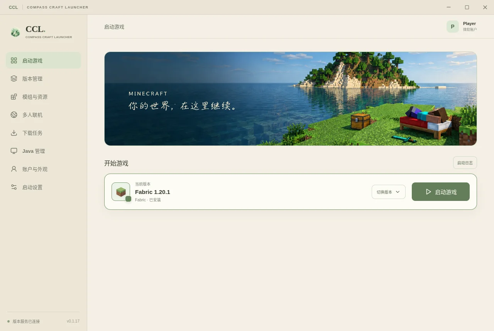
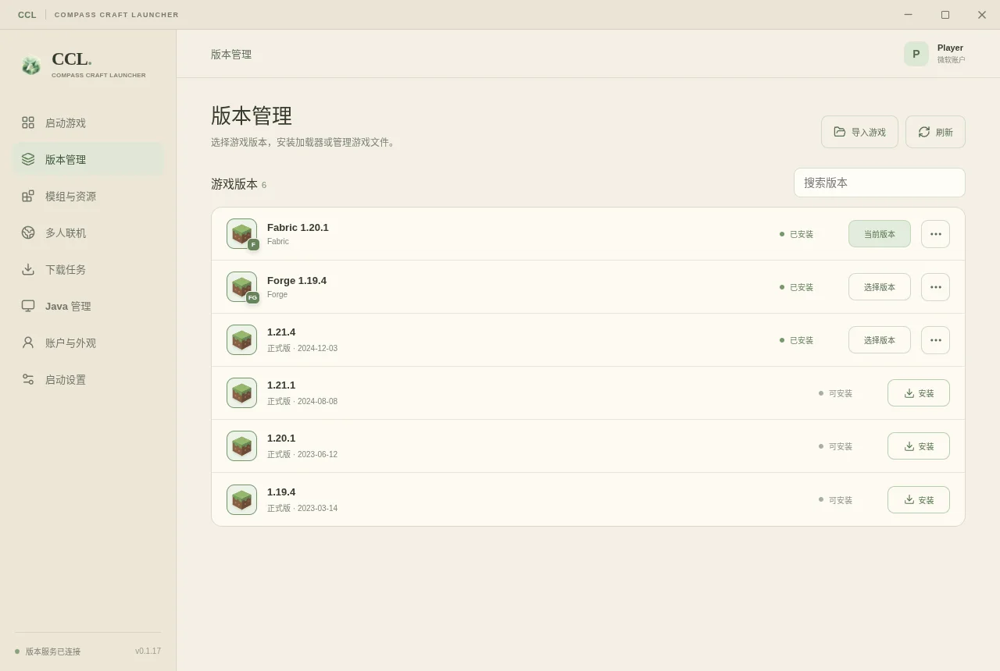
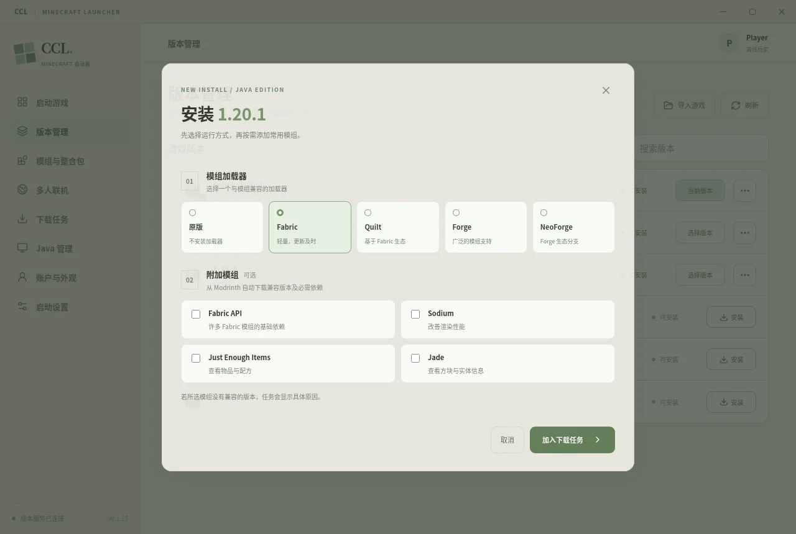
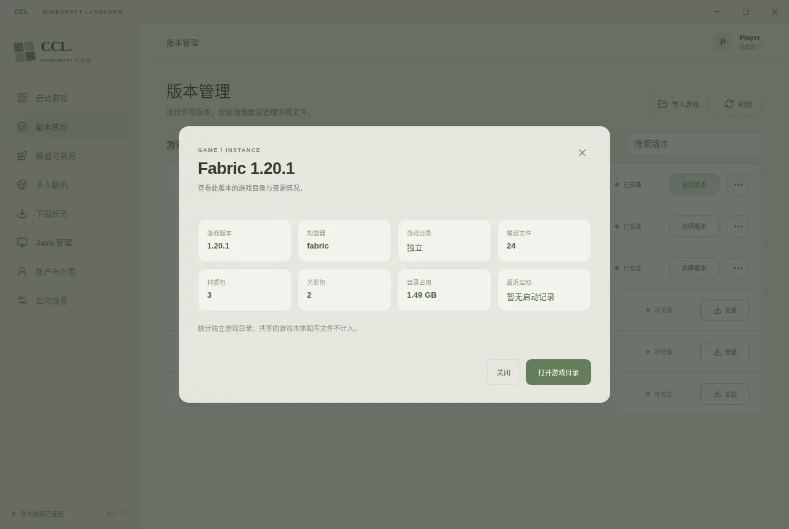
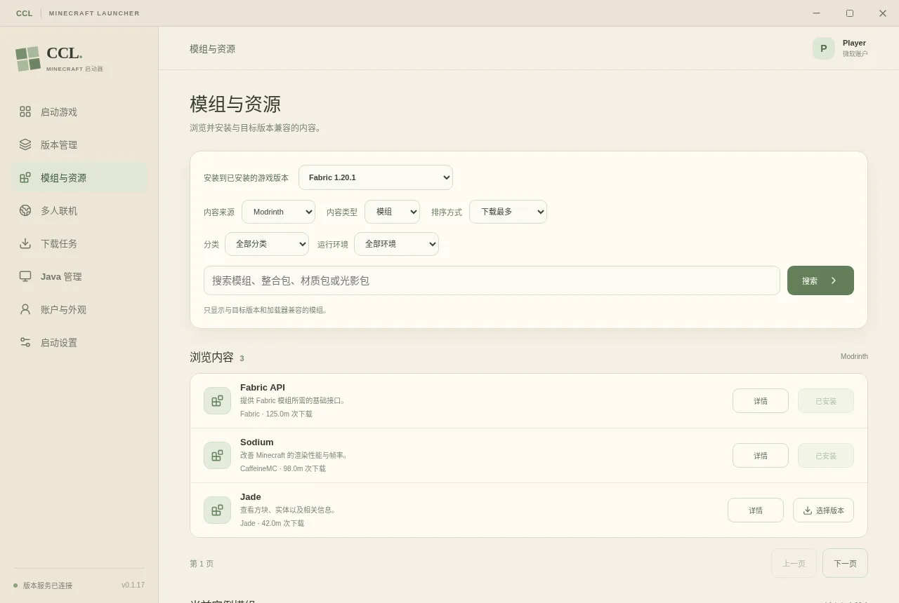
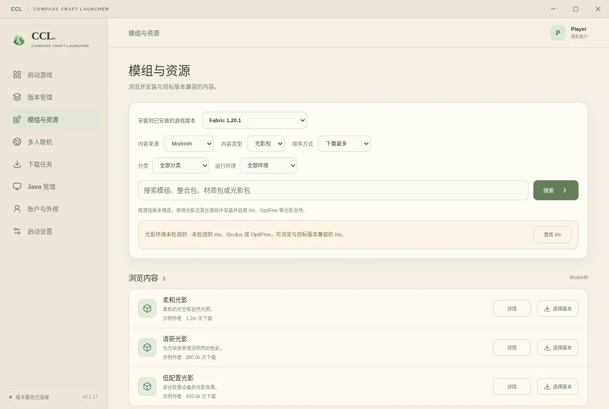
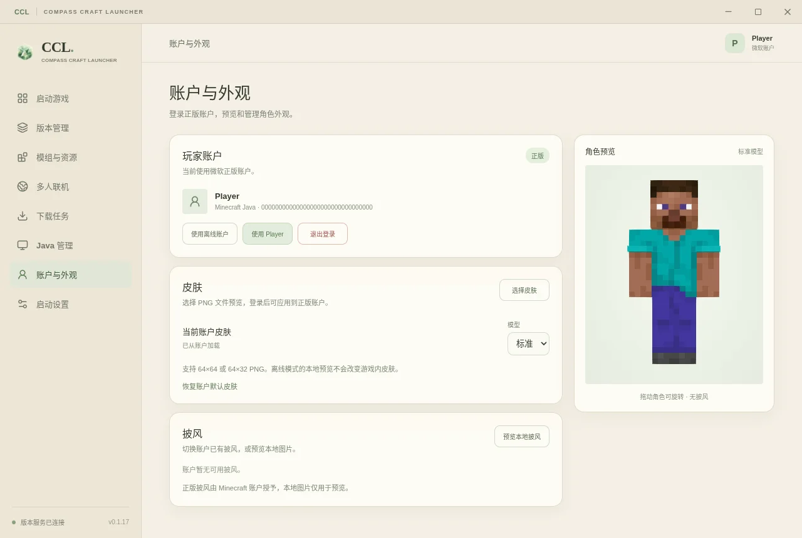

# Compass Craft Launcher (CCL)

**Compass Craft Launcher（CCL）是一个使用 Tauri 2 构建的跨平台 Minecraft: Java Edition 启动器。** 从安装游戏、管理模组到与朋友联机，CCL 希望让这些事情在同一个简洁的界面里完成。

[下载最新版本](https://github.com/Zennho/ccl/releases/latest) · [报告问题](https://github.com/Zennho/ccl/issues) · [服务器目录](https://github.com/Zennho/ccl-server-catalog) · [MIT 许可证](LICENSE)

Compass Craft Launcher (CCL) is an independent, open-source Minecraft: Java Edition launcher for Windows, Linux and macOS. It is not affiliated with Mojang or Microsoft.



*界面截图中的账户、游戏版本及内容列表为示例数据。*

## 下载与安装

前往 [Releases](https://github.com/Zennho/ccl/releases) 下载适合自己系统的安装包：

| 平台 | 安装包 |
| --- | --- |
| Windows x64 | `x64-setup.exe` |
| Linux x64 | `amd64.deb` 或 `amd64.AppImage` |
| macOS Apple Silicon | `aarch64.dmg` |
| macOS Intel | `x64.dmg` |

Windows 安装包尚未进行代码签名；macOS 包使用临时签名，尚未经过 Apple 公证，系统可能提示需要手动确认打开。游戏及其资源需要从各发布服务下载。

## 功能

- **游戏与加载器**：安装 Minecraft Java 版正式版，可同时选择 Fabric、Quilt、Forge 或 NeoForge，以及兼容的常用模组。安装前抽样比较官方与 BMCLAPI 镜像线路，优先使用较快的线路，失败时尝试备用线路。
- **Java 管理**：检测本机 Java，下载和管理 Eclipse Temurin Java 8、17、21 和 25，并校验下载文件。可用版本取决于发行商对当前平台的支持。
- **模组与整合包**：浏览、搜索和排序 Modrinth 或 CurseForge 的内容，按页浏览结果并打开项目原站，支持来源分类筛选；整合包可按游戏版本和加载器筛选，Modrinth 另可按运行环境筛选。近期的 Modrinth 搜索结果和缩略图会在当前会话短暂缓存。模组按选定游戏版本和加载器过滤，可选择具体版本、自动安装必需依赖，也可筛选并批量启用、停用或删除已安装的模组；支持检查可识别 Modrinth 模组的兼容版本更新，并根据本地模组元数据排查重复 ID、缺少依赖、已声明的冲突及部分游戏版本不匹配。详情页显示项目描述和来源平台提供的网址，并提供 MC 百科词条或搜索入口。整合包使用独立实例目录。
- **材质包与光影包**：通过 Modrinth 或 CurseForge 浏览、搜索并按游戏版本筛选，选择具体版本后加入下载队列，自动保存到目标游戏目录；可管理本地文件、打开文件夹并检查可识别项目的更新。光影页面会检测目标实例的支持组件；单个文件上限为 512 MB，下载后需在游戏中启用。CurseForge 需要 API 密钥，部分作者可能限制下载。
- **下载与版本管理**：可设置 1–5 个任务同时运行，支持取消、重试和清理记录。Java、材质包和光影包下载显示实时速度，文件大小已知时显示预计剩余时间；任务记录会保留，游戏、Java、模组、材质包和光影包任务中断后可重新尝试。版本管理可按需查看游戏版本、加载器、模组与资源包数量、目录占用及最近启动时间；版本可删除，默认保留存档、模组及共用资源，独立实例可选择连同实例数据一起删除。
- **实例备份与存档**：在版本管理中为实例或单个世界创建备份、恢复和删除备份，查看存档名称、游戏版本及最近游玩时间。恢复前自动备份当前实例，删除存档前自动备份该世界；操作前需退出该游戏目录中的游戏并等待下载任务结束。
- **导入与导出**：支持 CCL 游戏包和 PCL 使用的 Modrinth `.mrpack` 格式，可导出模组、游戏与模组配置和资源包，并可选包含世界存档；CCL 格式还支持保存启动参数。导入时创建独立实例，并重新下载游戏与加载器。PCL 兼容导出暂不支持 Quilt，导入整合包中的可选客户端文件会一并安装。
- **实例主题与游戏档案**：为已安装的实例设置封面、主题颜色和简介；选中实例时封面用于主页横幅和启动唱片。游戏档案记录通过 CCL 启动的次数与进程运行时长，并可分页查看、放大截图或打开截图文件夹。
- **账户与外观**：支持离线玩家及多个微软正版账户，可添加和切换账户。Windows 和 Linux 使用系统凭据库；macOS 使用本地受限权限文件保存登录状态。正版头像按账户缓存在本机，后台恢复登录期间先显示缓存，获取最新皮肤后更新。可预览皮肤和披风、上传正版皮肤并切换账户已有披风；离线皮肤可按实例同步到 CustomSkinLoader 的本地皮肤目录。主界面横幅和全局背景支持本地图片、透明度、磨砂与模糊调整。
- **多人联机**：为游戏内开放的局域网端口创建 IPv6 转发，分享地址并检测 TCP 连接；也可以浏览每日更新的 [公开服务器目录](https://github.com/Zennho/ccl-server-catalog)，搜索、分页和跳转到指定页；目录聚合多个公开来源并按地址去重。
- **自动检查更新**：启动后及运行期间定期检查 GitHub 最新正式版，也可在设置中手动检查；发现新版本时可打开 Release 页面下载安装。
- **界面外观**：默认主页横幅随本机时间切换白天、傍晚和夜晚场景；也可自定义横幅和背景，分别调整透明度、磨砂与模糊效果。
- **启动设置与日志**：可为当前版本切换版本隔离，分别保存存档、模组和配置；整合包始终隔离，切换目录时不会移动已有数据。最大内存支持手动设置，也可在启动时根据设备总内存和可用内存自动分配。可为当前实例单独保存 Java、内存、G1GC 和自定义启动参数；也可配置全局参数及网络代理。启动日志保存在游戏目录的 `logs/ccl` 中；异常退出时会分析启动日志及明确关联的崩溃报告，提示常见问题和排查步骤，并可打开完整日志。检测到游戏窗口出现后自动返回主页，如果无法检测窗口可手动返回。

## 界面展示

**游戏启动** · 启动过程中显示唱片动画，可使用自定义背景和横幅。


**版本与内容** · 管理游戏版本，安装时选择加载器及附加模组；在内容页浏览模组、整合包、材质包和光影包。

| 版本管理 | 选择加载器和附加模组 |
| --- | --- |
|  |  |



**模组与资源** · 按游戏版本浏览模组、整合包、材质包和光影包，并选择具体版本下载。





**账户与外观** · 预览角色皮肤，管理正版账户的皮肤与披风。



*版本管理、安装配置、实例概览、内容浏览和账户外观截图使用示例数据。*

## 使用须知

- **正版登录**：CCL 已配置微软应用，玩家无需输入客户端 ID；该应用已获得 Minecraft 服务授权。离线模式无法加入要求正版验证的服务器。Windows 和 Linux 将刷新令牌保存在系统凭据管理器中；macOS 将令牌保存在 `~/Library/Application Support/ccl/account-credentials`，目录权限为 700、文件权限为 600，但文件未加密，同一用户下可读取文件的程序可以获取令牌。macOS 旧版保存的钥匙串账户需要重新登录一次。在线账户会在后台恢复；若启动游戏时尚未完成，会等待或重新尝试验证。离线账户启动时不等待联网。
- **账户与实例设置**：可在“账户与外观”添加和切换已保存的正版账户，退出登录只移除当前选择的账户。实例独立启动设置按游戏目录和版本保存在本机，未设置时使用全局配置；目前不包含在备份或导出包中。
- **离线皮肤**：选择本地皮肤后，可将其应用到当前实例；启动该实例时会同步当前选择的皮肤和离线玩家名。游戏内显示需要安装兼容当前版本和加载器的 CustomSkinLoader，页面提供组件搜索入口；原版没有该模组时不会生效。组件的皮肤源优先级和缓存可能影响结果，其他玩家默认看不到本地皮肤。清除预览不会删除已经写入游戏目录的皮肤文件。
- **材质包与光影包**：在“模组与资源”选择内容类型和已安装的目标版本，然后打开项目详情选择文件版本。材质包保存在游戏目录的 `resourcepacks`，光影包保存在 `shaderpacks`；启用版本隔离时使用对应的独立游戏目录。本地列表也显示手动添加的 ZIP 或资源包文件夹；项目安装标记和更新检查依据 CCL 安装记录，无法识别手动添加文件的项目来源。可在启动器中筛选、删除和打开文件夹，下载后须在游戏中启用。光影环境检测会读取目标实例的加载器和模组元数据，并可引导查找 Iris 或 Oculus；检测结果不保证实际兼容性。
- **中文介绍与 MC 百科**：内容列表和详情会通过 Buggcraft Translate 查询中文译文，详情缺少译文时尝试申请生成；AI 译文可能有误，可切换回原文。模组和整合包通过非官方 MC 百科查询服务匹配项目原站链接，匹配成功后可直达百科页面，无法确认时提供百科搜索。第三方服务不可用或未收录时继续显示原文；这些查询会向服务发送公开的项目 ID、原文哈希或项目名称。
- **CurseForge**：浏览和下载需要自行提供 API Key；部分项目作者不允许第三方启动器下载文件。Modrinth 模组通过文件哈希识别；CurseForge 模组通过 CCL 安装记录识别。
- **联机与服务器**：跨网络连接需要双方有可互通的 IPv6，房主的路由器与防火墙允许入站 TCP。房间没有额外访问验证，请只向信任的人分享地址。公开服务器目录来自多个公开来源，无法覆盖所有服务器；在线状态和人数是快照，不代表实时状态。单个来源更新失败时会标记旧快照或不可用。
- **实例主题与游戏档案**：实例主题保存在当前设备；封面使用本地图片存储，未设置时沿用全局横幅。游玩时长从此功能启用后开始记录，游戏进程结束时结算；若启动器先于游戏退出，本次时长可能无法记录。共用目录的截图可能来自其他版本，单张预览上限 12 MB。实例主题和游戏档案暂不包含在游戏备份或导出包中。
- **备份与存档**：备份位于游戏目录的 `ccl-backups/instances/<版本>`，仅包含模组、配置、资源包、存档和常用游戏设置，不包含游戏本体、共享库和日志。未开启版本隔离时，多个版本可能共用同一游戏目录，恢复或删除存档会影响这些版本。恢复前自动创建完整实例备份；识别不到的模组及无法解析的版本规则不会被判定为无冲突。
- **游戏数据**：默认游戏目录位于系统应用数据目录下的 `ccl/minecraft`，可在启动设置中修改。删除版本默认保留共用数据；选择删除独立实例数据时，实例内的存档和模组也会删除。导出包不包含日志、截图和账户信息。
- **下载**：带 SHA-1 校验的游戏文件下载会保留未完成片段，取消、网络中断或重启后重试可续传；下载完成后校验文件，其他类型的临时文件仍会清理。已完成的共用游戏资源可以保留并在重新安装时复用。若整合包取消前已完成游戏本体或加载器安装，这些内容也会保留。带校验值的游戏文件及材质包、光影包会流式写入临时文件；网络中断后自动有限重试，服务器支持时在同一次任务内续传，完成后校验再保存。资源包等下载的未完成临时文件会在取消或任务结束时清理；导入导出任务重启后需要重新选择。

## 从源码开发

### 环境准备

安装 Node.js 22、Rust，以及 [Tauri 2 对应平台的系统依赖](https://v2.tauri.app/start/prerequisites/)。Linux 构建需要 WebKitGTK、D-Bus 等开发包，Windows 需要 Microsoft C++ 构建工具和 WebView2，macOS 需要 Xcode 命令行工具；以 Tauri 文档为准。

```bash
git clone https://github.com/Zennho/ccl.git
cd ccl
npm ci
npm run tauri dev
```

常用命令：

```bash
npm run check                              # 版本一致性、前端测试和构建
npm test                                   # 下载队列及界面交互测试
cargo fmt --manifest-path src-tauri/Cargo.toml --check    # Rust 格式检查
cargo test --manifest-path src-tauri/Cargo.toml --locked  # Rust 后端测试
npm run build                              # 构建前端资源
npm run tauri build                        # 构建当前平台的桌面安装包
```

提交和拉取请求会运行 [检查工作流](.github/workflows/check.yml)，验证版本一致性、前端测试和构建、Rust 格式及后端测试。桌面安装包通常需要在对应操作系统上构建；[发布工作流](.github/workflows/release.yml) 分别构建 Windows、Linux 和两种 macOS 架构，并在所有构建成功后发布。

发布新版本时，将 `package.json`、`package-lock.json`、`src-tauri/Cargo.toml`、`src-tauri/Cargo.lock` 与 `src-tauri/tauri.conf.json` 的版本号同步，更新 `.github/release-notes.md`，运行 `npm run check:version`，然后手动运行发布工作流。工作流会使用项目版本号创建对应的 Git 标签和 Release。

构建者可以通过 `CCL_MICROSOFT_CLIENT_ID` 环境变量覆盖默认微软应用 ID。自行注册的应用需要支持个人账户、启用公共客户端流程、将 `http://localhost` 注册为移动和桌面应用重定向 URI，并获得 Minecraft 服务授权；参考 [微软桌面应用注册文档](https://learn.microsoft.com/en-us/azure/active-directory/develop/scenario-desktop-app-registration)。

## 项目结构

```text
src/                  界面、交互与样式
src/job-manager.js    下载队列、进度、取消和恢复
src-tauri/src/        Tauri 命令、游戏安装、账户与其他后端功能
tests/                界面交互及下载队列测试
scripts/              开发与版本一致性检查
.github/workflows/    跨平台构建与发布流程
```

## 参与贡献

欢迎提交 [Issue](https://github.com/Zennho/ccl/issues) 或 Pull Request。报告问题时请提供系统、CCL 版本、复现步骤以及相关日志；提交代码前请运行适用的测试，并说明修改内容和验证方式。涉及账户、代理或日志时，请先移除密码、令牌和其他个人信息。

## 许可证与声明

本项目采用 [MIT License](LICENSE)，第三方组件许可见 [THIRD-PARTY-NOTICES.txt](THIRD-PARTY-NOTICES.txt)。Minecraft、Mojang 和 Microsoft 是其各自所有者的商标；CCL 是独立项目，与 Mojang 或 Microsoft 没有隶属关系。
